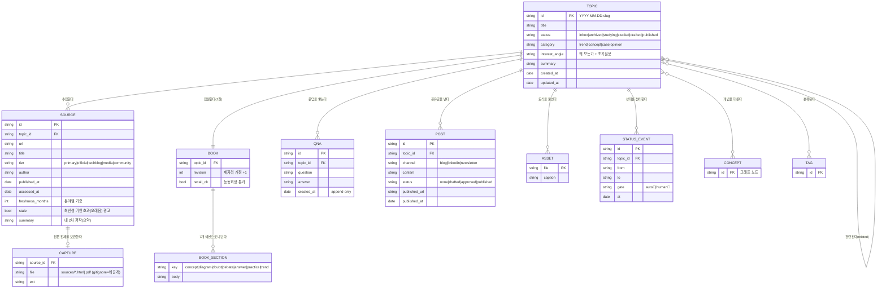
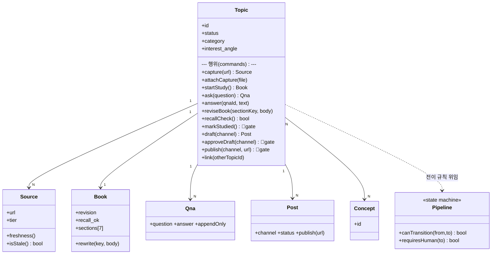
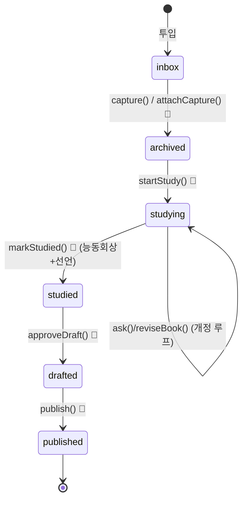
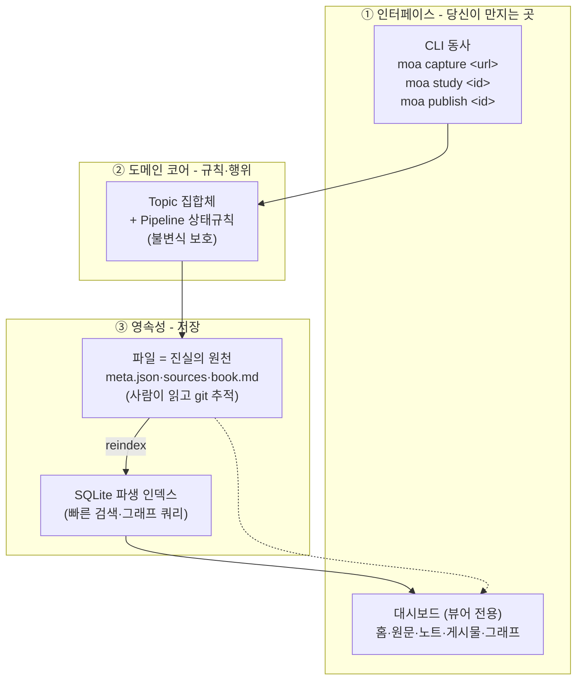

# 🏛 모아(Moa) — 서비스 아키텍처

> 🧭 **상태 (2026-11-13 기준)**: 이 문서는 **2026-11-10 제품 비전 초안(코드 전)**이다.
> 현재 실제 구현은 `server/ahkaiving` **헥사고날 백엔드**이고, 아래 비전 중 **일부 슬라이스만** 실현됐다:
> - ✅ 구현됨: `Material`(코드명 `ArchiveItem`) 수집·원본보존·추출·요약 — 상태 `pending→preserved→extracted→enriched`.
> - ⏳ 미구현(로드맵): `Topic`·`Book`(학습서 7섹션)·`Qna`·`Post`(3포맷 발행)·능동회상·HITL 발행 게이트·SQLite 인덱스·그래프.
> - ⚠️ 용어/상태명이 아래 다이어그램(inbox→…→published, Topic 중심)과 다르다. **현재 진실은
>   [`CLAUDE.md`](./CLAUDE.md)와 [`server/README.md`](./server/README.md).** 이 문서는 방향성·로드맵으로만 읽는다.

> 목적: "매번 파일을 손으로 만지는 프로토타입"을 **반복 사용 가능한 서비스**로 만들기 위한 설계 판정 문서.
> 순서: ① 유사 서비스 판정 → ② 데이터 모델(ERD) → ③ 객체지향 모델 → ④ 상태 머신 → ⑤ 행위(Command) 목록 → ⑥ 재사용성 아키텍처.
> 작성: 2026-11-10 · 아직 구현 아님 — **합의용 초안**.

---

## ① 유사 서비스 판정 — "이미 있는 거 아냐?"

우리가 하려는 전체 루프:
**관심자료 수집 → 원문 보관 → 대화로 '책 집필식' 학습 → 3포맷 발행 → 대시보드·그래프로 관리.**

| 서비스 | 겹치는 부분 | **안 하는 것 (= 우리 차별점)** |
|---|---|---|
| **Readwise Reader + Ghostreader** | 읽기·보관·AI 질답 | 책 집필식 학습서, 3포맷 발행, HITL 승인 |
| **Glasp** | 하이라이트·학습·소셜 공유 | 대화형 심화, 상태 파이프라인 |
| **Heptabase / Obsidian / Logseq** | 카드·지식그래프 | 자동 수집·발행 파이프라인, 능동회상 |
| **Recall / Mem / Reflect** | AI 요약·자동 연결 | 능동회상·HITL 게이트·발행 |
| **RemNote / Anki** | 능동회상·간격반복 | 원문 아카이브·공유글 생산 |
| **Notion** (이미 거부함) | 올인원 DB | 너무 범용·무거움, 학습·발행 흐름 없음 |

**판정:** 각 조각은 다 존재하지만, **"학습 = 한 권의 책 집필(7섹션·대화·능동회상) + HITL 승인 게이트 + 3포맷 발행"을 하나의 상태 파이프라인으로 묶은 서비스는 없다.** → 만들 가치 있음. 단, "또 하나의 노트앱"이 아니라 **이 파이프라인(행위의 순서)** 자체가 제품의 핵심이다. 그래서 아래를 *데이터*가 아니라 *행위* 중심으로 모델링한다.

---

## ② 데이터 모델 (ERD)

핵심 집합체(Aggregate Root)는 **Topic**(= 책의 한 챕터). 나머지는 전부 Topic에 매달린다.

**읽는 법:**
- `Topic 1 — N Source` : 한 토픽에 여러 출처(레딧/논문/테크블로그…)를 누적.
- `Topic 1 — 1 Book` : 학습서는 한 권, 대신 `revision`으로 제자리 개정(이력은 git).
- `Topic N — N Topic (related)` + `Topic N — N Concept` : 이게 **지식그래프**의 엣지가 된다.
- `STATUS_EVENT` : 상태 전이를 **기록**으로 남겨(누가·언제·게이트 통과) 파이프라인을 감사 가능하게.

---

## ③ 객체지향 모델 — 집합체 + 행위

데이터가 아니라 **행위(메서드)** 를 1급으로. `Topic`이 자기 상태 전이를 책임지는 **Aggregate Root**.

- **Topic이 모든 쓰기의 입구** — Source/Book/Post를 외부가 직접 수정하지 않고 `topic.capture()`, `topic.reviseBook()`처럼 Topic을 통해서만 바꾼다(불변식 보호: "원문은 신성", "산출물은 덮어쓰지 않음").
- **Pipeline** = 상태 전이 규칙만 담은 객체. "archived 없이 studying 못 감", "studied/drafted/published는 사람 승인 필요" 같은 규칙을 한 곳에.

---

## ④ 상태 머신 (행위가 상태를 바꾼다)

🤖 자동 통과 · 🙋 **사람 승인 3대 관문**(학습완료·공유초안·발행). 임의로 못 건너뜀.

---

## ⑤ 행위(Command) 목록 — "서비스는 이 동사들의 집합"

재사용성의 핵심: **매번 파일 편집이 아니라, 이 동사 하나를 실행**하면 된다.

| 행위(동사) | 하는 일 | 상태 변화 | 게이트 |
|---|---|---|---|
| `capture(url)` | WebFetch로 출처 요약 → Source 추가 | inbox→archived | 🤖 |
| `attachCapture(file)` | 원문 전체 캡처 보관(비공개) | — | 🤖 |
| `startStudy()` | book 초안 + 질문 3~5개 생성 | archived→studying | 🤖 |
| `ask()/answer()` | 문답 누적(append-only) | — | 🤖 |
| `reviseBook(key)` | 학습서 제자리 개정 revision+1 | — | 🤖 |
| `recallCheck()` | 능동회상 통과 표시 | — | 🤖 |
| `markStudied()` | 학습완료 선언 | studying→studied | 🙋 |
| `draft(channel)` | 3포맷 중 하나 초안 | studied→drafted | 🤖 |
| `approveDraft(channel)` | 톤·길이 승인 | — | 🙋 |
| `publish(channel,url)` | 발행 확정 | drafted→published | 🙋 |
| `link(topicId)` | 그래프 엣지 추가 | — | 🤖 |
| `reindex()` | items.json·data.js 재생성 | — | 🤖(매 행위 후) |

---

## ⑥ 재사용성 아키텍처 — "계속 쓰는 모습"으로

현재가 "안 쓰게 되는" 이유 = **행위가 없고 파일만 있다.** 아래 3계층으로 분리하면 매 사용이 "동사 1개 실행"이 된다.

**핵심 결정 3가지 (여기가 당신이 판정할 지점):**

1. **진실의 원천 = 파일 유지** (meta.json + 마크다운). 이유: 사람이 읽고, git으로 이력·백업, 데이터 소유권 100% 당신. SQLite는 **읽기 전용 파생 인덱스**로만(검색·그래프 속도). → *"파일이 주인, DB는 캐시."*
2. **행위를 CLI 동사로 노출**: `moa capture/study/draft/publish …`. 이게 "계속 쓰는 서비스"의 실체. 지금의 `scripts/status.mjs`를 이 동사 집합으로 일반화.
3. **대시보드는 끝까지 뷰어**(쓰기 없음). 학습 대화는 Claude Code에서, 결과는 파일→인덱스→대시보드로 흐른다.

---

## 판정이 끝나면 (다음 단계 후보)
- [ ] 이 ERD/행위 모델 **확정**(필드·행위 가감)
- [ ] `moa` CLI 뼈대 — 위 동사 12개를 도메인 코어 호출로
- [ ] (선택) SQLite 파생 인덱스로 검색·그래프 쿼리
- [ ] 대시보드를 인덱스 기반으로 재배선
