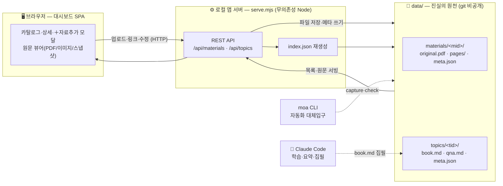
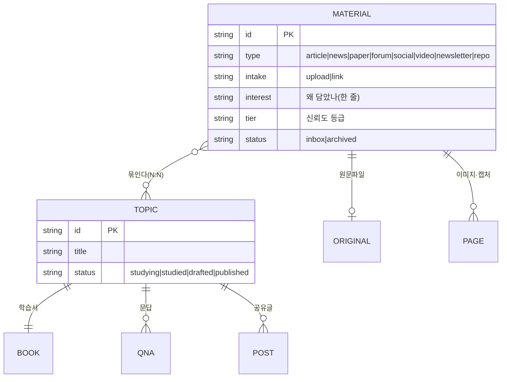
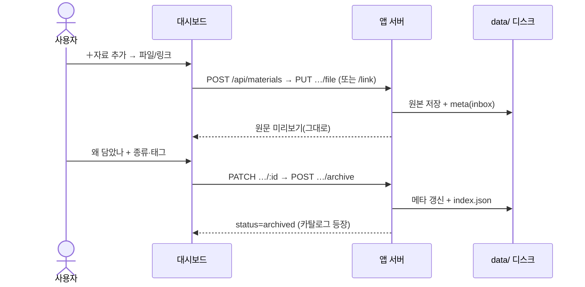

# 🧭 AH!카이빙 — 정보구조 · 유저플로우 · 백엔드 설계

> 🧭 **상태 (2026-11-13 기준)**: **2026-11-10 설계 초안(코드 전).** 핵심 전환(자료=1급 객체,
> 로컬 앱 서버, 원문 그대로 보존·뷰어)은 `server/ahkaiving`로 **실현**됐으나 세부가 갈라졌다:
> - 백엔드는 node `serve.mjs`가 아니라 **Python/FastAPI**. 업로드는 `PUT …/file` 스트리밍이 아니라 **`POST /api/materials` 멀티파트**.
> - `Material`은 구현됨(= `ArchiveItem`). **`Topic`·`Book`·`Qna`·`Post`·주제 묶기·발행은 미구현(로드맵).**
> - 상태명이 다름: 실제는 `pending→preserved→extracted→enriched`.
> - **현재 진실은 [`CLAUDE.md`](./CLAUDE.md)·[`server/README.md`](./server/README.md).** 이 문서는 유저플로우·IA 참고용.

> 목적: "파일을 손으로 만지는 지침"에서 **사이트만으로 동작하는 로컬 앱**으로 전환.
> 확정(2026-11-10): 로컬 앱 서버 + 백엔드 / 자료(Material) 1급 객체 / 원문은 그대로 전부 보존·표시.
> 상태: **설계 합의용 초안** (코드 전).

---

## 0. 시스템 구조도

### (가) 컴포넌트 구조 — 사이트가 입구, 파일은 디스크


### (나) 데이터 모델 — 자료 N:N 주제


### (다) 인테이크 시퀀스 — 자료 담기


---

## 1. 정보구조 (IA) — 자료와 주제를 분리

핵심 전환: **'자료'가 '주제' 없이도 혼자 존재**한다. 아카이빙(자료 보존)과 학습(주제로 묶어 공부)을 구조로 분리.

```
자료(Material)  ──N:N──  주제(Topic)
   원문 1개                자료들을 묶은 공부 단위
   혼자 아카이빙됨          학습서(book)·문답(qna)·공유글(share)
```

| 객체 | 무엇 | 가진 것 | 단계 |
|---|---|---|---|
| **Material (자료)** | 원문 하나: PDF·이미지(PPT캡처)·링크·영상 | 원문파일/스냅샷 + 출처메타 + 왜담나 + 종류·태그·등급 | **아카이빙** |
| **Topic (주제)** | 자료 여러 개를 공부용으로 묶음 | material_ids[] + book.md + qna.md + share/ | **학습·발행** |

- 자료는 **주제 0개**여도 됨("일단 담아둠"). 나중에 1개 이상 주제에 들어갈 수 있음(N:N).
- 아카이빙 완성도(포착·보존·정위)는 **자료 단위**로 판정.

### 데이터 레이아웃 (디스크 = 진실의 원천, 그대로 유지)

```
data/
  materials/<mid>/
     meta.json          종류·출처·왜담나·태그·등급·상태(inbox|archived)·topic_ids[]
     original.<ext>      업로드 원본 (PDF 등) — 그대로 보존
     pages/ 01.png …     이미지·PPT 캡처 여러 장
     snapshot.html       링크형: 저장한 원문 스냅샷(선택)
     extracted.md        (선택) 본문 텍스트 추출 — 검색·학습용
  topics/<tid>/
     meta.json          title·category·interest·material_ids[]·learning·share·publish·status
     book.md  qna.md  share/{blog,linkedin,newsletter}.md  assets/
  index.json            파생 인덱스(목록·검색·그래프) ← 서버가 갱신
```
> 기존 `archive/<topic>/`(2건)은 topics/ + materials/ 로 **마이그레이션**(스크립트 1회).
> `.gitignore`: 레포 비공개이므로 원본도 커밋(원문 무조건 보관 원칙).

---

## 2. 유저 플로우 — 사이트 안에서 끝난다

### (가) 자료 담기 (아카이빙) — Claude Code 없이 사이트에서
```
[+ 자료 추가]
  ① 넣기            파일 드래그·업로드(PDF/이미지)  또는  링크 붙여넣기(URL)
  ② 원문 미리보기    올리는 즉시 원문 그대로 렌더 (PDF뷰어 / 이미지갤러리 / 스냅샷)
  ③ 왜 담았어요?     ← 사람이 주는 단 한 줄(필수). + 출처(자동추출·수정) + 종류·태그·등급
  ④ 저장            → status=archived, 카탈로그에 등장. 원문 전체 열람 가능.
```
- ③은 과거 "포착 메타"였던 자리 — UI엔 **"왜 담았어요? (한 줄)"** 과 분류 필드만 평범하게 노출.
- 종류는 업로드 확장자·URL로 **자동 추정**(PDF→논문, 이미지→슬라이드, youtube→영상…) 후 사용자가 고침.

### (나) 공부하기 (학습) — 주제로 묶어 Claude Code에서
```
자료 N개 선택 → [주제로 묶기] → Topic 생성 → (Claude Code) book.md 집필·문답 → studied
```
### (다) 공유 (발행)
```
Topic → 공유글 3종 초안 → 승인 → 발행(blog 고유링크)   (기존과 동일)
```

---

## 3. 원문 "그대로" 뷰어

| 종류 | 저장 | 표시 |
|---|---|---|
| 논문·리포트 | `original.pdf` | PDF 전체 임베드(브라우저 PDF 뷰어) |
| PPT·슬라이드·인포그래픽 | `pages/*.png` | 멀티페이지 이미지 갤러리 |
| 아티클·뉴스·블로그 | url(+`snapshot.html`) | 스냅샷 iframe + 외부 원문링크 ↗ |
| 포럼·소셜 | url / 스크린샷 | 캡처 이미지 / 스냅샷 |
| 영상 | url(+자막) | 임베드 플레이어 + 트랜스크립트 |

---

## 4. 백엔드 (로컬 앱 서버) — 무의존성 Node

`scripts/serve.mjs`를 정적서버 → **앱 서버**로 승격. 외부 패키지 없이 Node 내장 `http`만.
업로드는 멀티파트 대신 **원시 바디 스트리밍**(우리 프론트가 직접 호출하므로 간단·견고):
`PUT /api/materials/:id/file?name=slides.pdf` 로 File을 body에 그대로 → 디스크에 저장.

### API
```
POST   /api/materials                본문 {type?} → 빈 자료 생성(inbox), mid 반환
PUT    /api/materials/:id/file?name=  원본 파일 업로드(스트리밍 저장). 이미지 여러장 반복.
POST   /api/materials/:id/link        {url} → 메타·스냅샷 저장(서버 fetch)
PATCH  /api/materials/:id             {interest, type, tags, tier, title, source…} 수정
POST   /api/materials/:id/archive     완성도 검사 통과 시 status=archived
DELETE /api/materials/:id
GET    /api/materials                 목록(필터·정렬은 프론트)
GET    /api/materials/:id/original    원본 파일 그대로 서빙(PDF/이미지/html)

POST   /api/topics                    {title} → 주제 생성
POST   /api/topics/:id/materials      {material_ids[]} 자료 묶기/풀기
GET/PATCH/DELETE /api/topics/:id
GET    /api/index                     파생 인덱스(목록·그래프)
GET    /  …                           대시보드 정적 파일
```
- 모든 쓰기 후 `index.json` 재생성(기존 build 로직 재사용).
- `moa` CLI는 같은 디스크를 만지는 **대체 입구**로 공존(스크립트 자동화용).
- Claude Code는 학습·요약 등 '머리 쓰는' 일만. 아카이빙 인테이크는 **사이트가 전담**.

---

## 5. 지을 순서 (합의 후)
1. 데이터 레이아웃 전환 + 기존 2건 마이그레이션 스크립트
2. 앱 서버(`serve.mjs`) + 업로드/링크/CRUD API
3. 프론트: **[+ 자료 추가]** 모달(업로드·링크 → 원문 미리보기 → 왜담나·분류 → 저장)
4. 원문 뷰어(PDF/이미지갤러리/스냅샷)를 상세·카탈로그에 연결
5. 주제 묶기 UI → 학습·발행은 기존 흐름 연결
